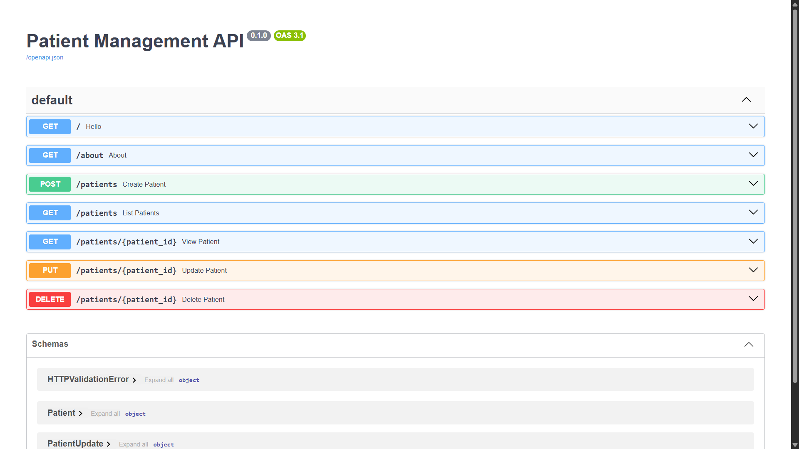

# Patient Management API

A REST API built with **FastAPI** and **Pydantic v2** to manage patient records, with input validation, automatically computed BMI and sorting.

## Features
- Full CRUD: create, read, update and delete patients
- Pydantic validation with field constraints and a custom validator
- BMI and health verdict (underweight / normal / overweight / obese) computed automatically
- Sorting by height, weight, BMI or age
- Proper HTTP status codes: 201, 400, 404 and 422
- JSON file storage with crash-safe writes
- Interactive API docs (Swagger UI) generated by FastAPI

## Tech stack
Python, FastAPI, Pydantic v2, Uvicorn

## Project structure
```
patient-api/
├── main.py
├── patients.json
├── requirements.txt
├── README.md
└── screenshots/
    └── swagger.png
```

## Run locally
```bash
git clone https://github.com/<your-username>/patient-api.git
cd patient-api
python -m venv .venv
source .venv/bin/activate      # Windows: .venv\Scripts\activate
pip install -r requirements.txt
uvicorn main:app --reload
```
Then open http://127.0.0.1:8000/docs

## Endpoints
| Method | Path | Description | Status codes |
|---|---|---|---|
| GET | `/` | Welcome message | 200 |
| GET | `/about` | About the API | 200 |
| POST | `/patients` | Create a patient | 201, 400 (duplicate ID), 422 |
| GET | `/patients` | List patients, optional `?sort_by=bmi&order=desc` | 200, 422 |
| GET | `/patients/{id}` | Get one patient | 200, 404 |
| PUT | `/patients/{id}` | Update a patient (partial update) | 200, 404, 422 |
| DELETE | `/patients/{id}` | Delete a patient | 200, 404 |

`sort_by` accepts `height`, `weight`, `bmi` or `age`. `order` accepts `asc` or `desc`.

## Example
Create a patient:
```bash
curl -X POST http://127.0.0.1:8000/patients \
  -H "Content-Type: application/json" \
  -d '{"id": "P001", "name": "Rahul Sharma", "city": "Delhi", "age": 25, "gender": "male", "height": 1.75, "weight": 70}'
```
Response:
```json
{
  "message": "Patient created successfully",
  "patient": {
    "id": "P001",
    "name": "Rahul Sharma",
    "city": "Delhi",
    "age": 25,
    "gender": "male",
    "height": 1.75,
    "weight": 70.0,
    "bmi": 22.86,
    "verdict": "normal"
  }
}
```

## Screenshot


## Limitations
- JSON file storage is not safe for concurrent writes, so a database is the natural next step.
- No authentication yet.

## Coming next
**Part 2:** ML prediction endpoint, built on top of this API.

## Author
Atharva Srivastava
- LinkedIn: [linkedin.com/in/atharva-srivastava-848b21385](https://linkedin.com/in/atharva-srivastava-848b21385)
- GitHub: [github.com/<your-username>](https://github.com/<your-username>)
